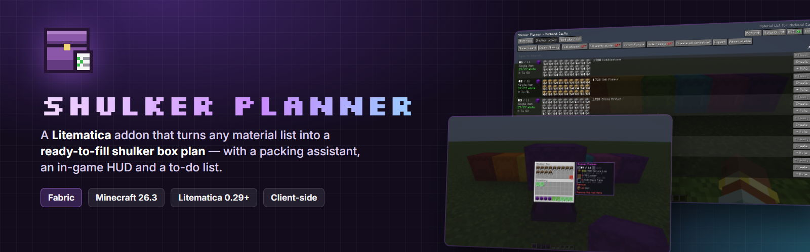
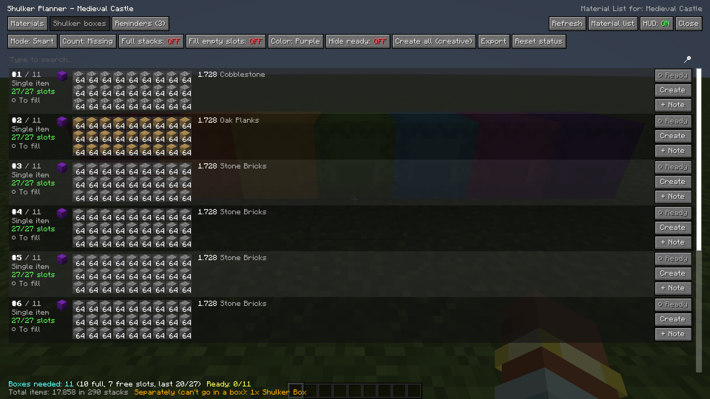
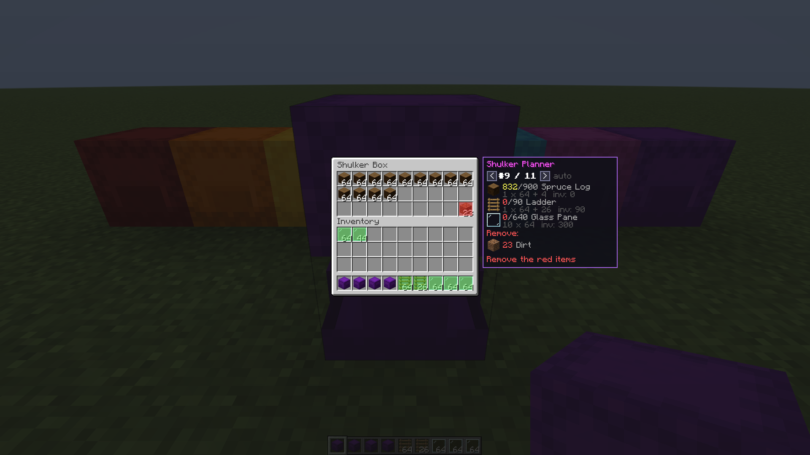
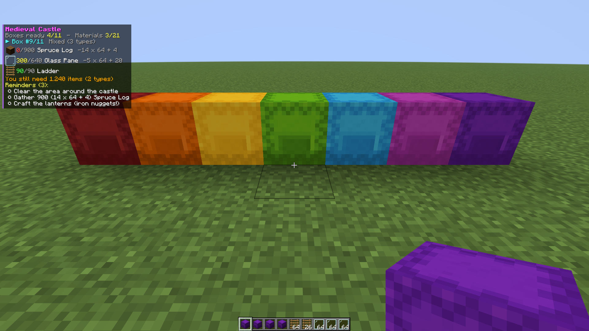
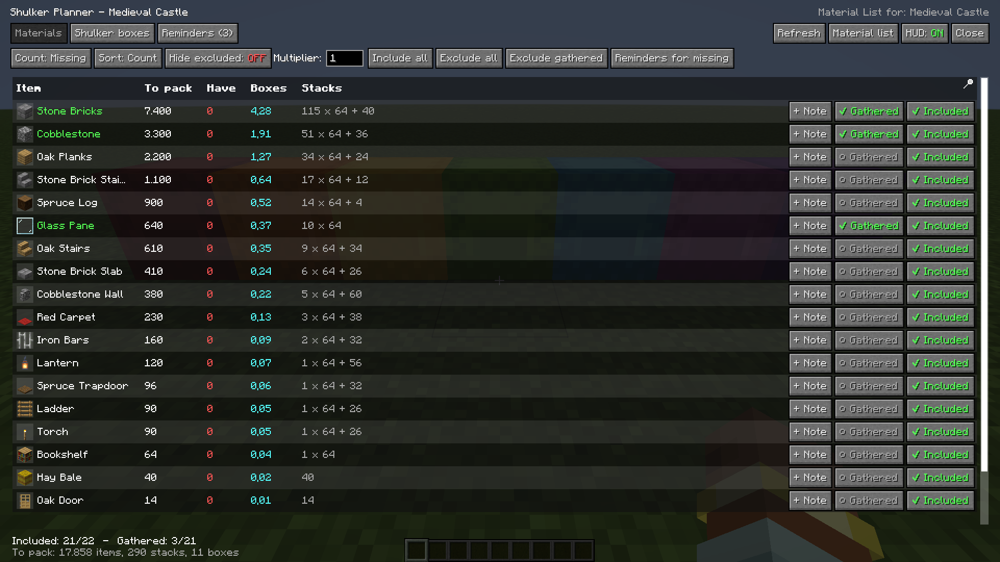
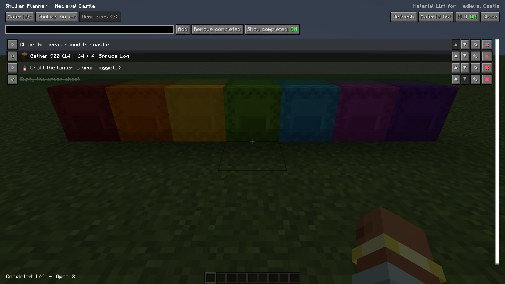

<p align="center">
  
</p>

<p align="center">
  <a href="https://github.com/gamebaiters/LitematicaShulkerboxPlanner/releases"></a>
  
  
  
  <a href="LICENSE"></a>
</p>

**Shulker Planner** is an addon for [Litematica](https://modrinth.com/mod/litematica). It takes the material list of your schematic and tells you exactly **how many shulker boxes you need and what goes in each one**, slot by slot.

When you get to packing, it shows next to the open box what still goes in, keeps a HUD on screen with the box you're filling, and gives you a to-do list for everything else.

It's for the moment before a big build, when you'd otherwise be staring at a list of 40 materials and doing stack math in your head.

---

## Features

### The plan, box by box
Every box is shown as a 9×3 grid, exactly as it will look in game.

- **Minimum number of boxes.** Stack sizes (64 / 16 / 1) and the 27 slots of a box are always respected.
- **Three packing modes:**
  - **Smart:** single-item boxes for bulk materials, then the leftovers grouped so that as few items as possible get split.
  - **Sequential:** everything in category order.
  - **One item per box:** never mixes item types.
- **Options:** round every item up to full stacks, fill leftover slots with spares, and pick the box color.
- Items that can't go in a shulker box (shulker boxes themselves) are listed separately, so you don't forget them.

<p align="center"></p>

### Packing assistant
Open any shulker box and a panel appears next to it.

- It shows which planned box this is, what is already inside, what's still missing and how much of it you're carrying.
- Items to move in are highlighted **green**, wrong items **red**.
- When the box matches the plan it's marked as ready on its own.

<p align="center"></p>

### In-game HUD
A compact overlay with:
- the project's progress;
- the box you're working on, with every item you still need (counting what's loose in your inventory);
- your open reminders.

Toggle it with **M + H** or the *HUD* button in the planner.

<p align="center"></p>

### Materials and reminders
- **Materials tab:**
  - Include or exclude any item, and mark items as gathered.
  - Choose what to count: total, still missing in the world, or still to gather (missing minus what you already carry, including inside boxes and bundles).
  - Multiplier for building the same thing several times.
- **Reminders tab:**
  - A simple to-do list that is saved with the schematic.
  - Every material and every box has a *+ Note* button. One click creates a reminder for each missing material.

<p align="center">
  
  
</p>

### Also
- **Creative mode:** *Create* / *Create all* puts the boxes in your inventory, already filled and named (`#3/11 Stone Bricks`).
- **Automatic detection:** filled boxes in your inventory are recognised and counted as ready. Identical boxes are counted one by one.
- **Export:** the whole plan goes to a text file, or Shift + click copies it to the clipboard.
- **Saved per schematic:** everything lives in `config/shulkerplanner/projects/`. The HUD keeps working after a restart, even before the material list is re-created.
- **Languages:** English and Italian.

---

## How to use it

1. Load a schematic and open its **Material List** in Litematica (`M + L`).
2. Press **Shulker Planner** in the bottom right corner.
   - You can also use the button in the Litematica main menu, or `M + B` with a placement selected.
3. Pick a packing mode and what to count, and exclude anything you don't want to carry.
4. Fill the boxes. The assistant and the HUD show what's left.

| Hotkey | Action |
|---|---|
| `M + B` | Open the planner for the current material list / selected placement |
| `M + H` | Toggle the HUD |
| *(unbound)* | Open the reminders page, open the configuration |

All hotkeys and options can be changed in the configuration screen. It's reachable from Mod Menu, the malilib config list, or the planner itself.

## Installation

Requires **Minecraft 26.3**, **Fabric Loader 0.19+**, [Litematica](https://modrinth.com/mod/litematica) 0.29.1+ and [MaLiLib](https://modrinth.com/mod/malilib) 0.30.2+ (and Fabric API, which MaLiLib already needs).

Download the jar from the [releases](https://github.com/gamebaiters/LitematicaShulkerboxPlanner/releases) and drop it in your `mods` folder. It's client-side only, so it works on any server.

## FAQ

**Does it count what's already placed in the world?**
Yes. With a placement material list and the *Missing* count mode, only the blocks still to be placed are packed.

**Why does a box with the right items not show as ready?**
Detection compares the exact contents: same items, same amounts. Boxes inside your ender chest aren't checked.

**Works with Litematica Printer / Tweakeroo / Sodium / Iris?**
Yes. It's been tested together with a full Fabulously Optimized profile.

## Building

```bash
./gradlew build                # the mod jar ends up in build/libs/
./gradlew test                 # packing algorithm tests
./gradlew runClientGameTest    # starts the game, checks everything and takes the screenshots
```

Needs JDK 25. `bash tools/media/render.sh` turns the game test screenshots into the images in `docs/`.

## Italiano

Addon per Litematica che calcola quante shulker box servono per una schematica e cosa mettere in ognuna, slot per slot. Include un assistente di riempimento, un HUD in gioco con la shulker in corso e una lista di promemoria. Il gioco in italiano mostra l'interfaccia tradotta.

## License

[LGPL-3.0](LICENSE) - made by **MarcoTech81** and the **GameBaitersCrew**.
