<p align="center">
  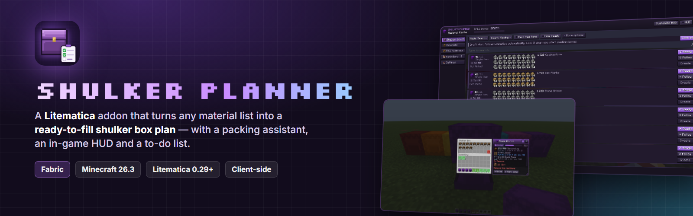
</p>

<p align="center">
  <a href="https://github.com/gamebaiters/LitematicaShulkerboxPlanner/releases"></a>
  
  
  
  <a href="LICENSE"></a>
</p>

**Shulker Planner** is an addon for [Litematica](https://modrinth.com/mod/litematica). It takes the material list of your schematic and tells you exactly **how many shulker boxes you need and what goes in each one**, slot by slot.

When you get to packing, it shows next to the open box what still goes in, keeps a HUD on screen with the box you're filling, and gives you a to-do list for everything else.

It's for the moment before a big build, when you'd otherwise be staring at a list of 40 materials and doing stack math in your head.

---

## Features

### The plan, box by box
Every box is shown as a card with its 9×3 grid, exactly as it will look in game, and its state: *To fill*, *Filling*, *Ready*.

- **Minimum number of boxes.** Stack sizes (64 / 16 / 1) and the 27 slots of a box are always respected.
- **Three packing modes:**
  - **Smart:** single-item boxes for bulk materials, then the leftovers grouped so that as few items as possible get split.
  - **Sequential:** everything in category order.
  - **One item per box:** never mixes item types.
- **Options:** round every item up to full stacks, fill leftover slots with spares, pick the box color, pack the raw materials instead of the finished blocks.
- **A plan that stays put.** While you're still choosing, the plan follows the material list (*Draft*). As soon as you start (mark a box, link a shulker box) or press *Lock plan*, boxes keep their number and contents. If the material list changes you get a banner, and *Update plan* repacks only the boxes you haven't started.
- Items that can't go in a shulker box (shulker boxes themselves) are listed separately, so you don't forget them.

<p align="center">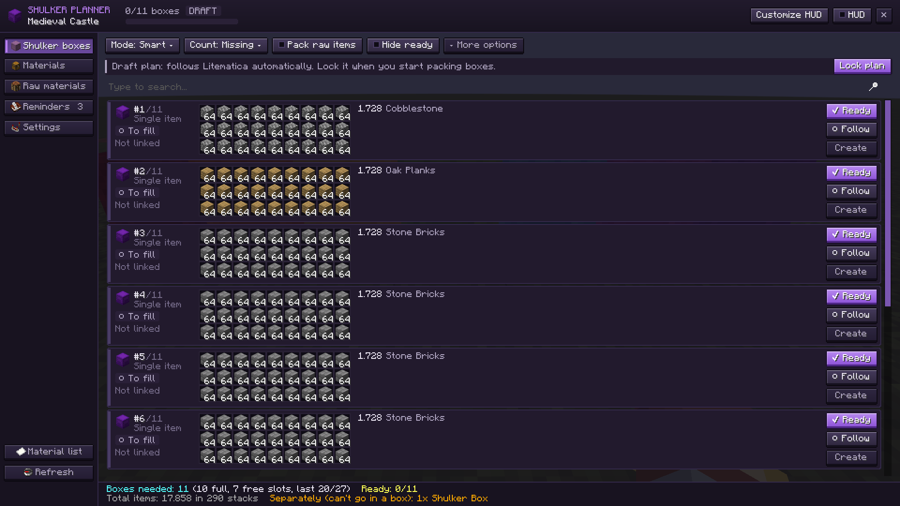</p>

### Packing assistant
Open any shulker box and a panel appears next to it.

- **You decide which box it is.** A new shulker box is never assigned on its own: the panel shows a preview of the suggested box, you pick one with ◀ ▶ and press **Link**.
- **The link follows the shulker box.** Break it, carry it, place it somewhere else: it's still that box (recognised by color, name and contents).
- It shows what is already inside, what's still missing and how much of it you're carrying. Items to move in are highlighted **green**, wrong items **red**, too many **orange**.
- When a linked box matches the plan it's marked as ready on its own. *Unlink*, *Mark done* and *Follow on HUD* are one click away.

<p align="center">
  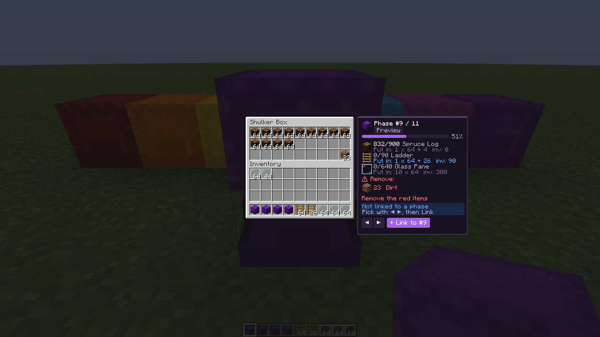
  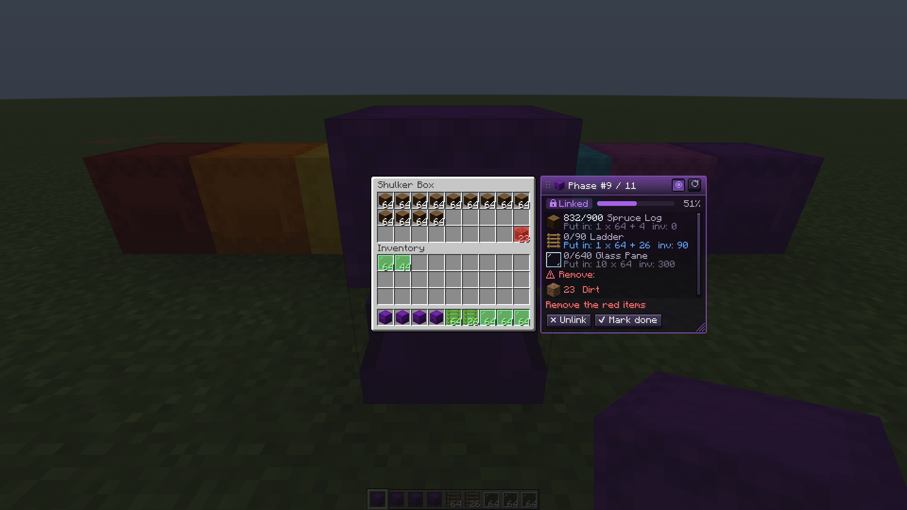
</p>

### In-game HUD
An overlay that follows you while you build and pack:
- the **schematic name** and the overall progress;
- the box you're filling, drawn as the **real shulker box interface**. Every slot is colored: already inside, in your inventory ready to put in, partially there, or missing;
- a compact list of **what's still missing**, in stacks (`2 x 64 + 12`) or plain numbers;
- items that ended up in the wrong box;
- your open reminders.

Everything updates live. The box's contents are tracked while it's open, and a half-filled box in your inventory is recognized too.

Toggle it with **M + H**.

<p align="center">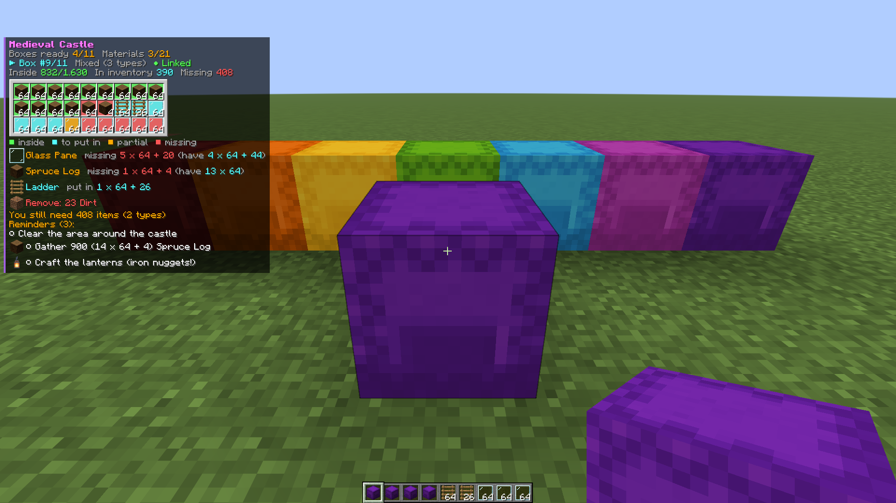</p>

### Customize the HUD
Every schematic has its own HUD. Open the editor with **M + J** (or *Customize HUD* in the planner):
- **Move** it by dragging, **resize** it from the bottom right corner or with the mouse wheel (50% - 250%).
- **Title:** type any name, or leave it empty to use the schematic name.
- **Themes and colors:** 7 themes, and every color (background, side bar, border, title, text, labels, and the four state colors) can be set by hex code or by clicking its swatch. Background opacity has its own slider.
- **Elements:** turn on or off every single part, or pick a quick view (Full, Shulker box, List only, Minimal, Reminders only). A hotkey (unbound by default) also cycles the views.
- **Layout:** compact mode, padding, text shadow, side bar, border, how many items and reminders to show, stacks or plain numbers.
- Save a style as the default for new schematics.

<p align="center">
  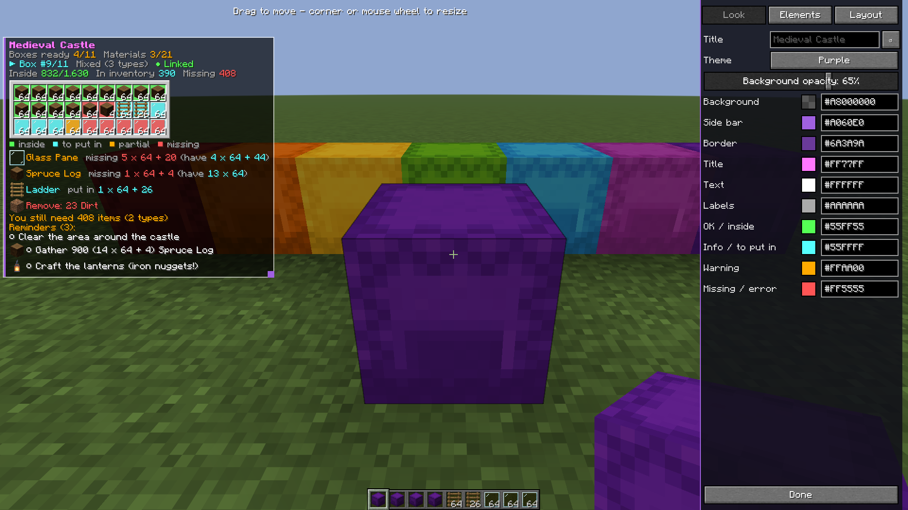
  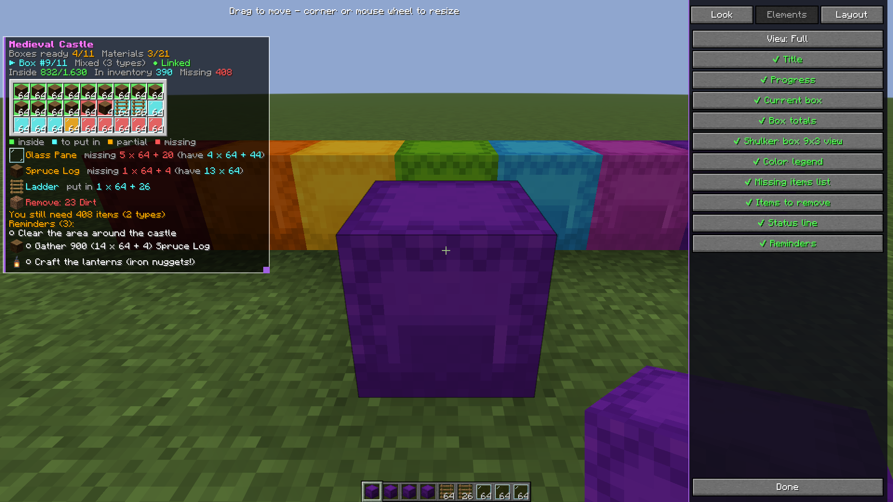
</p>
<p align="center">
  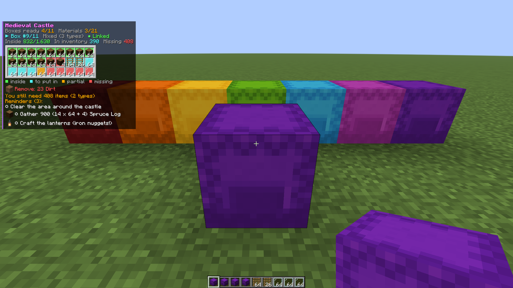
  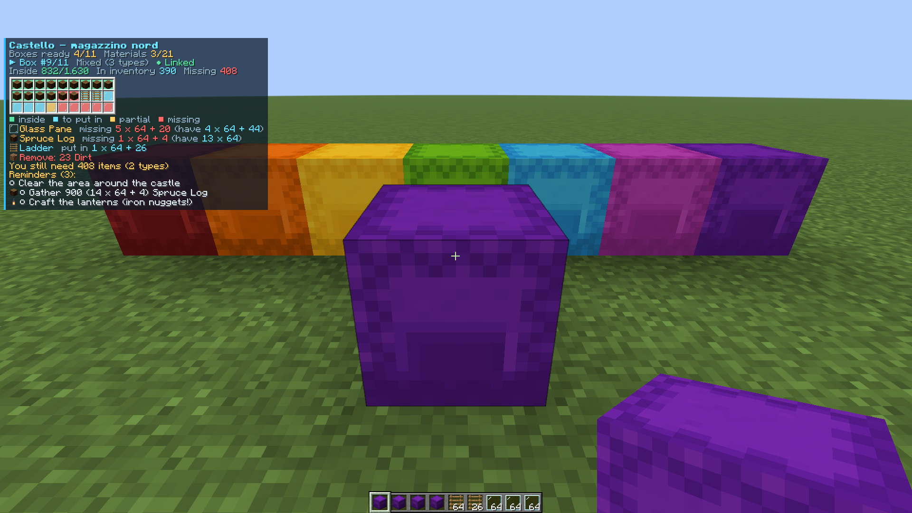
  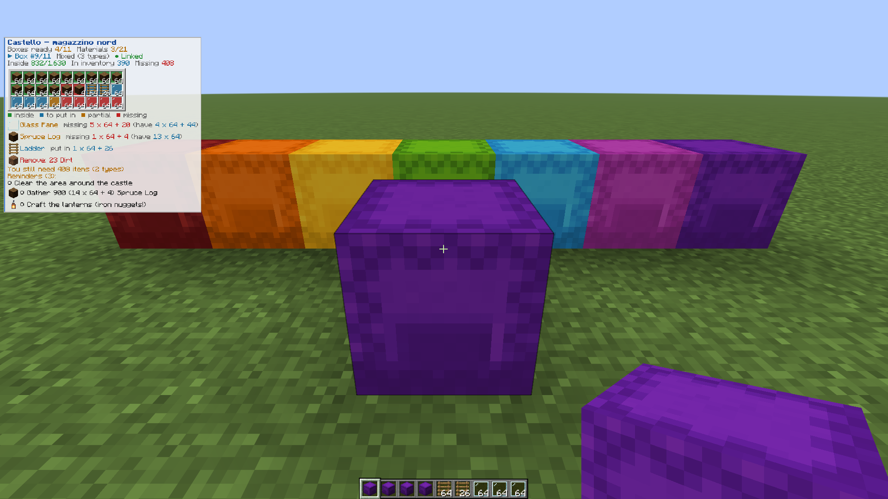
</p>

### Materials
- For every material: **Needed**, **Packed** (in boxes that are ready or being filled), **Carrying** (inventory, bundles, shulker boxes not linked to the plan) and **To get**, with a progress bar. Nothing is counted twice.
- Choose what to count: everything (*Total*) or only what's still missing in the world (*Missing*), with a multiplier for building the same thing several times.
- Include or exclude any item, mark items as gathered. Entries you hid in Litematica's material list are left out.

<p align="center">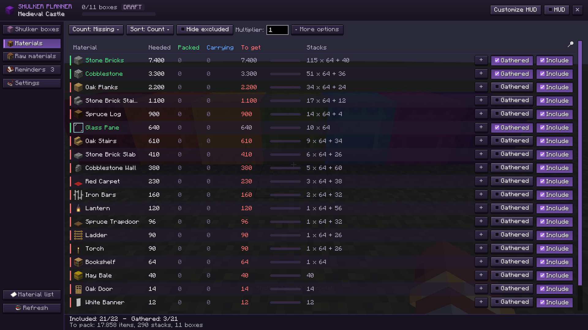</p>

### Raw materials
Everything on the list broken down into what you actually have to gather: cobblestone instead of stone bricks, logs instead of stairs, sand, raw iron...

- Every crafting step in order: how many crafts, at which station (crafting table, stonecutter, furnace, smithing table), the ingredients and the leftovers.
- Recipes come from the world in singleplayer (data packs and mods included) and from the game on servers.
- Turn the furnace or the stonecutter off, choose another recipe for an item, or keep an item as it is.
- *Pack raw items* plans the shulker boxes with the raw materials.

<p align="center">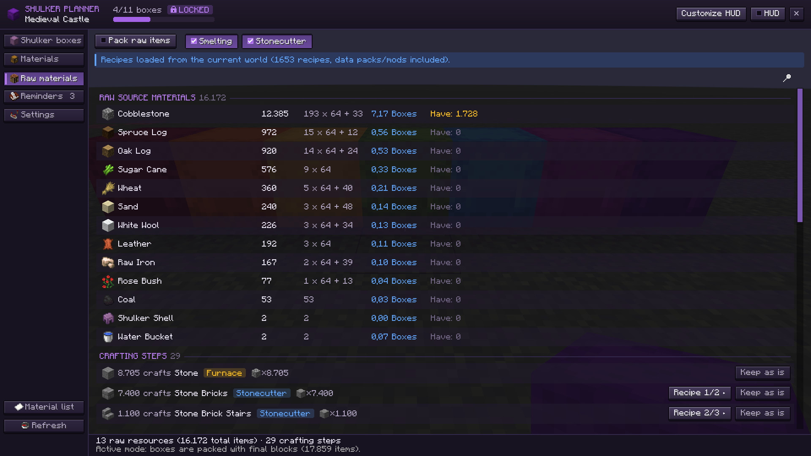</p>

### Reminders and settings
- **Reminders:** a simple to-do list saved with the schematic. Every material and every box has a *+ Note* button.
- **Settings:** every warning and highlight can be turned off on its own (items to remove, slot highlights, HUD warnings, hints, messages), or all at once.

<p align="center">
  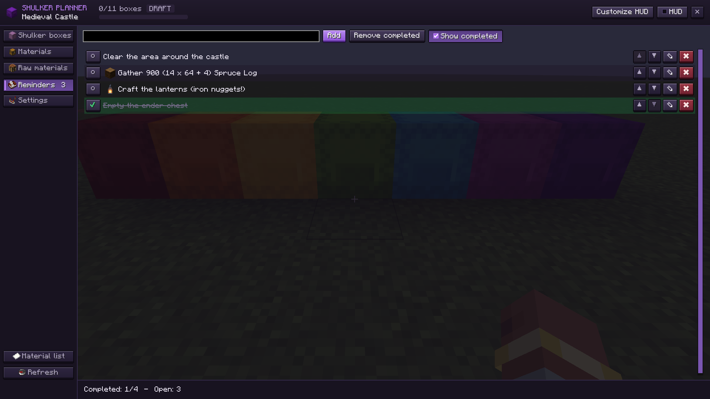
  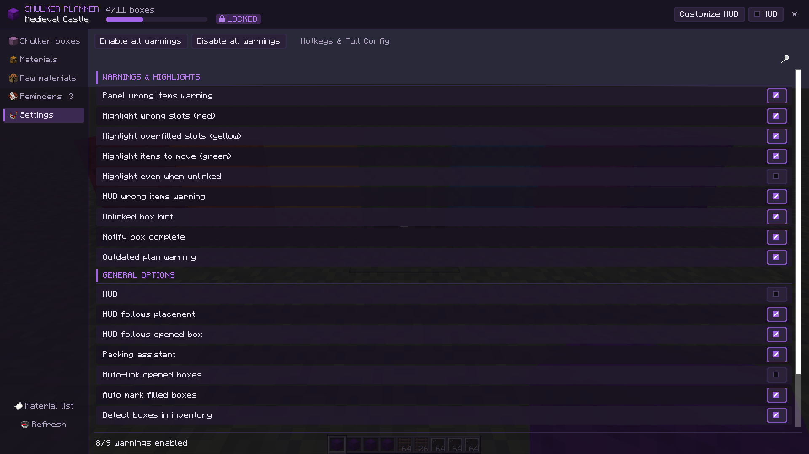
</p>

### Also
- **Creative mode:** *Create* / *Create all* puts the boxes in your inventory, already filled and named (`#3/11 Stone Bricks`).
- **Automatic detection:** filled boxes in your inventory that match a box exactly are counted as ready (can be turned off). Identical boxes are counted one by one.
- **Export:** the whole plan goes to a text file, or Shift + click copies it to the clipboard.
- **Saved per schematic:** everything lives in `config/shulkerplanner/projects/`. The HUD keeps working after a restart, even before the material list is re-created.
- **Languages:** English and Italian.

---

## How to use it

1. Load a schematic and open its **Material List** in Litematica (`M + L`).
2. Press **Shulker Planner** in the bottom right corner.
   - You can also use the button in the Litematica main menu, or `M + B` with a placement selected.
3. Pick a packing mode and what to count, and exclude anything you don't want to carry.
4. Open a shulker box, choose its box in the panel and press **Link**. Fill it: the assistant and the HUD show what's left.

| Hotkey | Action |
|---|---|
| `M + B` | Open the planner for the current material list / selected placement |
| `M + H` | Toggle the HUD |
| `M + J` | Customize the HUD (position, size, title, colors, elements) |
| *(unbound)* | Cycle the HUD view, open the reminders page, open the configuration |

All hotkeys and options can be changed in the configuration screen. It's reachable from Mod Menu, the malilib config list, or the planner itself.

## Installation

Requires **Minecraft 26.3**, **Fabric Loader 0.19+**, [Litematica](https://modrinth.com/mod/litematica) 0.29.1+ and [MaLiLib](https://modrinth.com/mod/malilib) 0.30.2+ (and Fabric API, which MaLiLib already needs).

Download the jar from the [releases](https://github.com/gamebaiters/LitematicaShulkerboxPlanner/releases) and drop it in your `mods` folder. It's client-side only, so it works on any server.

## FAQ

**Does it count what's already placed in the world?**
Yes. With a placement material list and the *Missing* count mode, only the blocks still to be placed are packed.

**Why does a box with the right items not show as ready?**
Detection compares the exact contents: same items, same amounts. Boxes inside your ender chest aren't checked.

**Works with Litematica Printer / Tweakeroo / Sodium / Iris?**
Yes. It's been tested together with a full Fabulously Optimized profile.

## Building

```bash
./gradlew build                # the mod jar ends up in build/libs/
./gradlew test                 # packing algorithm tests
./gradlew runClientGameTest    # starts the game, checks everything and takes the screenshots
```

Needs JDK 25. `bash tools/media/render.sh` turns the game test screenshots into the images in `docs/`.

## Italiano

Addon per Litematica che calcola quante shulker box servono per una schematica e cosa mettere in ognuna, slot per slot. Il piano resta fisso appena inizi a lavorarci; ogni shulker si collega a mano alla sua fase e resta collegata anche se la rompi e la ripiazzi altrove. Mostra per ogni materiale quanto serve, quanto è già impacchettato, quanto hai addosso e quanto manca, e può calcolare le materie prime (cobblestone, tronchi, sabbia...) con tutti i passaggi di crafting. Include un assistente di riempimento, un HUD in gioco personalizzabile per ogni schematica, una lista di promemoria e avvisi tutti disattivabili. Il gioco in italiano mostra l'interfaccia tradotta.

## License

[LGPL-3.0](LICENSE) - made by **MarcoTech81** and the **GameBaitersCrew**.
